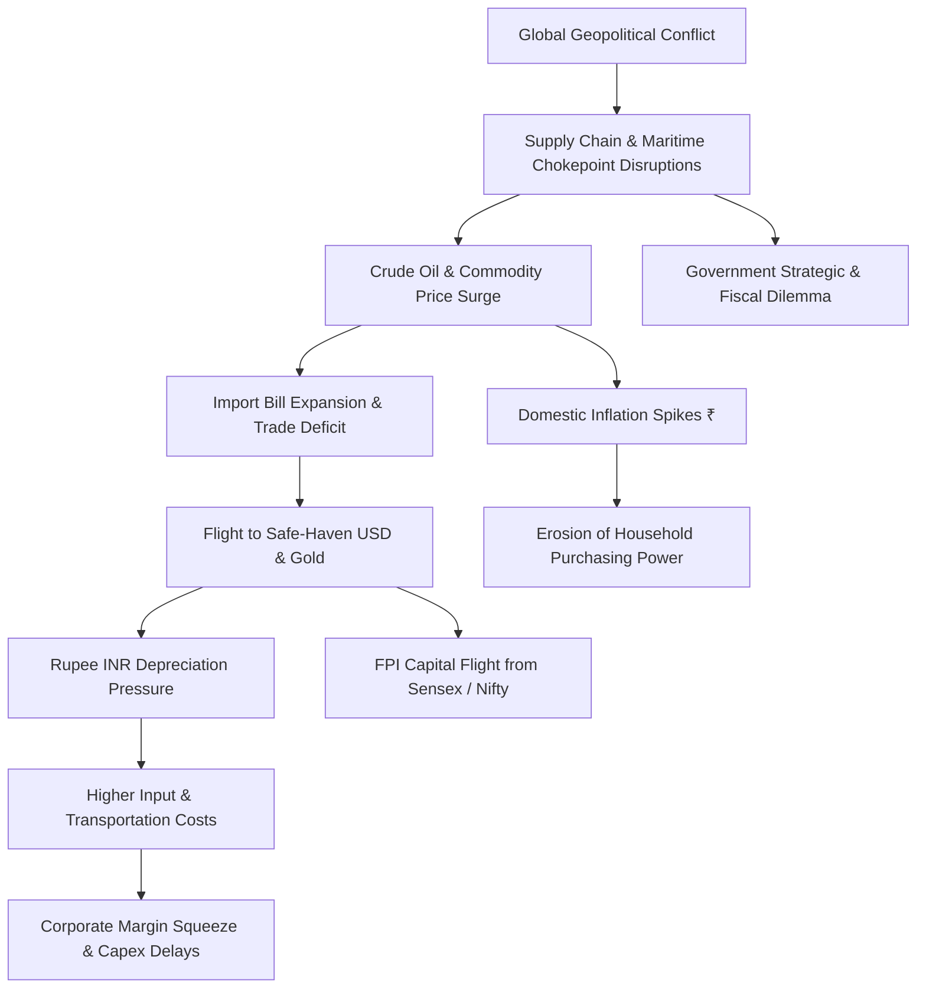

# How War Affects the Indian Economy and Its Financial System

> **Executive Macroeconomic Intelligence Briefing & Interactive Presentation Deck**  
> *A collaborative 9-member team research presentation exploring how distant geopolitical conflicts create profound transmission shocks across India's financial architecture, markets, currency, government priorities, and household wallets.*

---

## 📌 Executive Summary

Modern warfare is fought across two simultaneous fronts: the physical battlefield and the **battlefield of money**. In an increasingly interconnected global trade and financial ecosystem, military conflicts occurring thousands of kilometers away do not remain confined within geographical boundaries. 

For an emerging economy like **India**—which imports over 85% of its crude oil and is deeply integrated into global supply lines and foreign capital flows—external conflicts trigger severe transmission shocks:
- **Trade & Supply Disruptions:** Soaring crude oil, commodity, and freight prices.
- **Inflation & Currency Strain:** Weakening Indian Rupee (INR) against the US Dollar and diminished consumer purchasing power.
- **Market Volatility:** Foreign Portfolio Investment (FPI) outflows, equity sell-offs (Sensex/Nifty swings), and safe-haven rushes toward Gold and USD.
- **Fiscal & Geopolitical Strain:** Strategic balancing between defence procurement, citizen security (e.g., Indian maritime seafarers), and domestic development budgets.

> *"We may not be able to prevent every war, but we can prepare our economy to withstand its financial impact."*

---

## 🗺️ Transmission Mechanism Framework

The macroeconomic impact travels along a clear transmission corridor from external geopolitical flashpoints to the domestic consumer:



---

## 👥 9-Member Team Speaker Matrix

Each team member delivers a dedicated module addressing an integral dimension of the macroeconomic chain, complete with transitions and analytical takeaways:

| Member / Speaker | Slide ID | Module Topic | Core Focus & Economic Concept |
| :--- | :--- | :--- | :--- |
| **Person 1: Amrutha** | `slide-1` | **Introduction: The Financial Battlefield** | Global trade linkages, war as a financial shock, transmission concept. |
| **Person 2: Jaswanth** | `slide-2` | **Household Wallets & Currency** | Crude oil dependency, inflation, rupee pressure, wallet impact chain. |
| **Person 3: Prem** | `slide-3` | **Financial Markets & Safe Havens** | Brent crude volatility, INR depreciation, flight to Gold & US Dollar. |
| **Person 4: Srikar** | `slide-4` | **Stock Market Under Pressure (Sensex & Nifty)** | FPI outflows, Russia-Ukraine benchmark (-2,700 pts), sector asymmetry. |
| **Person 5: Prasanna** | `slide-5` | **Macro Economy & Citizen Livelihood** | GDP growth headwinds, supply chain bottlenecks, employment, food inflation. |
| **Person 6: Havila** | `slide-6` | **Government Response & Maritime Security** | Indian seafarers (1 in 10 globally), Black Sea/Red Sea security, 3-point peace proposal. |
| **Person 7: Swathi** | `slide-7` | **Core Strategic Challenges** | Import reliance, fiscal balancing (defence vs social welfare), corporate capex freezes. |
| **Person 8: Subhashita** | `slide-8` | **Solutions & Resilience Playbook** | Trade diversification, domestic manufacturing (Make in India), fiscal discipline. |
| **Person 9: Divya** | `slide-9` | **Synthesis & Grand Conclusion** | Systemic recap, resilience over prevention, final strategic statement. |

---

## 🎙️ Detailed Speaker Scripts & Module Outlines

The presentation script is organized sequentially to provide smooth handoffs between speakers.

---

### 🎙️ Person 1: Amrutha — Introduction & The Modern Battlefield
- **Slide Reference:** `slide-1`
- **Opening Transition:** Team & Topic Introduction
- **Core Speech:**
  > *"Good morning everyone. We are here to present our topic: **'How War Affects the Indian Economy and its Financial System.'**  
  > Before we start, let me introduce our team. We are a team of 9 members, and each of us will explain a different part of the topic.  
  > 
  > Before we go into the main topic, let me give you a simple introduction about what war is. When we hear the word war, the first things that come to our mind are soldiers, weapons, and destruction. But there is another battlefield that we often don't see — **the battlefield of money**.  
  > 
  > Today, countries are deeply connected. India buys from other countries, sells to them, and does business with people and companies around the world. So when a war happens somewhere, the impact doesn't always stop at the battlefield. It can travel through the connections between countries and eventually reach India.  
  > 
  > Think of it like this: A war starts in one part of the world… but its consequences travel much farther. And that is exactly what we are going to explore today — how a war outside India creates effects inside India's financial system. Instead of looking at war only as a military event, let's look at it as a financial shock that travels from one country to another.  
  > 
  > The battlefield may be far away… but the impact reaches our pockets, our businesses, and our country."*
- **Handoff Cue:**  
  > *(Person 2): "Now that we understand how war can reach India, let’s see how it affects our daily expenses, prices, and currency."*

---

### 🎙️ Person 2: Jaswanth — How War Hits Our Wallet (Prices & Currency)
- **Slide Reference:** `slide-2`
- **Topic:** The Impact of War on Prices, Fuel, and the Indian Rupee
- **Core Speech:**
  > *"Good morning everyone. Today, I am going to speak about **'How War Hits Our Wallet – The Impact of War on Prices and Currency.'**  
  > 
  > When we think about war, we think about destruction and loss of lives. But war also affects the economy and our daily expenses.  
  > 
  > First, war can disrupt the supply of oil, food, and raw materials. When supply decreases, prices usually increase. For India, this is especially important because we import a large amount of crude oil. Higher oil prices directly increase transportation and production costs, making everyday consumer products more expensive.  
  > 
  > Second, war causes inflation. Inflation means prices increase and the purchasing power of our money decreases. For example, ₹1,000 buys fewer goods and groceries than before.  
  > 
  > Another major impact is on the Indian rupee. During geopolitical uncertainty, international investors prefer safer assets and currencies like the US dollar. This weakens the rupee and makes our imports even more costly.  
  > 
  > So, the simple chain is:  
  > **War → Supply Disruption → Higher Prices → Inflation → Rupee Pressure → Higher Import Costs → Direct Impact on Our Wallet.**  
  > 
  > Therefore, even a war far away from India affects every household through fuel prices, food prices, inflation, and currency depreciation. Thank you."*
- **Handoff Cue:**  
  > *(Person 3): "We have seen how war reaches our wallets through prices and the rupee. Now, let’s look at how these changes affect the wider financial market."*

---

### 🎙️ Person 3: Prem — How War Meets the Financial Markets
- **Slide Reference:** `slide-3`
- **Topic:** Volatility, Crude Oil Spikes, and Safe-Haven Rushes
- **Core Speech:**
  > *"Good morning. Wars create short-term uncertainty and sharp market swings. India is particularly exposed when conflict disrupts oil supplies, because higher import costs directly pressure inflation, the rupee, and corporate margins.  
  > 
  > 1. **High Volatility:** News headlines regarding military escalation or supply chokepoints rapidly alter investor expectations, driving sharp intraday market swings.  
  > 2. **Rising Crude Oil Prices:** Fears of supply disruptions push Brent crude upward. For India, this expands the national import bill, inflating transport and operational costs across businesses.  
  > 3. **Rupee Depreciation:** Higher oil import bills boost dollar demand. Concurrently, global risk-off sentiment drives capital toward US dollar assets. While the Reserve Bank of India (RBI) utilizes foreign exchange reserves to smooth abrupt currency swings, structural depreciation pressure persists.  
  > 4. **Flight toward Gold and the US Dollar:** Investors shift capital out of risk assets into traditional safe havens. This bolsters gold and the greenback while depressing equity demand.  
  > 5. **Stock Market Jitters:** Uncertainty dampens institutional appetite. Oil-sensitive industries face immediate cost compressions while the broader market discounts macroeconomic risks."*
- **Handoff Cue:**  
  > *(Person 4): "We’ve seen the wider market reactions to war. Now, let’s focus specifically on the Indian stock market—the Sensex and Nifty 50."*

---

### 🎙️ Person 4: Srikar — Stock Market Under Pressure (Sensex & Nifty 50)
- **Slide Reference:** `slide-4`
- **Topic:** FPI Capital Flight, Sectoral Asymmetry, and Market Fundamentals
- **Core Speech:**
  > *"Good afternoon, ladies and gentlemen. So far, we have seen how wars affect different sectors and the Indian economy. Now, let's step into the shoes of investors and look at the direct impact on the Indian stock market — **Sensex and Nifty 50**.  
  > 
  > To begin with, the most immediate impact is **market volatility**. Geopolitical uncertainty breeds fear, triggering sharp sell-offs. For example, when the Russia-Ukraine conflict broke out in February 2022, the **Sensex crashed by over 2,700 points in a single trading session**.  
  > 
  > Moving from sentiment to capital flows, **foreign institutional investment (FPI) declines**. Foreign portfolio investors frequently withdraw capital from emerging markets and park it in safe-haven US Treasuries and cash, putting dual pressure on Indian equities and the rupee.  
  > 
  > Furthermore, crude oil remains India’s vulnerability: higher oil bills expand inflation and pinch corporate margins, while a declining rupee makes foreign input sourcing more punitive. Beyond energy, global trade lines face freight cost escalation and container delays.  
  > 
  > However, **the impact is not equal across all sectors**:
  > - **Negatively Impacted:** Aviation, paints, logistics, and automotive sectors face steep fuel and raw material input costs.
  > - **Positively Positioned:** Defence manufacturers, metals and commodities, and upstream oil & gas exploration companies frequently experience revenue boosts.  
  > 
  > To conclude:  
  > **'War creates the shock, but economic fundamentals determine its duration and ultimate impact on the Indian stock market.'** Thank you."*
- **Handoff Cue:**  
  > *(Person 5): "The stock market is only one part of the picture. Let’s now see how these effects spread to the wider Indian economy and people’s livelihoods."*

---

### 🎙️ Person 5: Prasanna — Macroeconomic Ramifications & Citizen Livelihoods
- **Slide Reference:** `slide-5`
- **Topic:** Economic Growth (GDP), Employment Headwinds, and Household Pressure
- **Core Speech:**
  > *"Good morning everyone. Today, I am going to speak about the broader impact of war on the Indian economy and citizen livelihoods.  
  > 
  > War affects India across multiple macro dimensions:  
  > 1. **Employment Pressures:** As input costs rise and global demand slows, businesses face profitability headwinds, curtailing hiring and expansion opportunities.  
  > 2. **Tempered Economic Growth:** Supply bottlenecks and elevated inflation force central banks to maintain restrictive monetary conditions, moderating GDP expansion.  
  > 3. **Food and Commodity Inflation:** Conflicts impacting agricultural exporters or fertilizer raw materials inflate basic grocery bills, creating real hardship for lower- and middle-income families.  
  > 4. **Supply Chain Bottlenecks:** Disrupted shipping lines create shortages of industrial inputs and critical consumer essentials.  
  > 
  > To conclude, war not only destroys lives on the front line, but also disrupts long-term economic development and living standards for ordinary families. Thank you."*
- **Handoff Cue:**  
  > *(Person 6): "We’ve seen how war affects jobs, prices, trade, and growth. Now, let’s understand what the Indian government does in response."*

---

### 🎙️ Person 6: Havila — Government Strategic Dilemma & Maritime Response
- **Slide Reference:** `slide-6`
- **Topic:** Citizen Protection (Seafarers), Shipping Chokepoints, and Sovereign Diplomatic Strategy
- **Core Speech:**
  > *"Good morning, everyone. As my teammates have outlined, conflict affects our markets, banking system, and domestic economy. Now, let me highlight a crucial dimension: **the impact of war on the Indian government and its sovereign strategic response.**  
  > 
  > First, consider our human footprint on global trade: **roughly 1 out of every 10 merchant seafarers globally is Indian.** These are civilian sailors, marine engineers, and deck officers operating commercial vessels. When conflict erupts in maritime corridors like the Black Sea or Red Sea, unarmed civilian Indian sailors find themselves trapped in active conflict zones. Attacks on merchant vessels create an urgent sovereign responsibility for India: safeguarding our citizens, executing maritime rescues, and demanding unhindered navigation under international law.  
  > 
  > Second, India took an active diplomatic posture by supporting a **three-part peace proposal**:  
  > 1. Halting attacks on energy infrastructure and critical civil facilities.  
  > 2. Keeping Black Sea maritime ports operational so food grains and fertilizers can reach developing economies.  
  > 3. Guaranteeing non-aggression against commercial shipping.  
  > 
  > Third, economic sovereignty: India depends heavily on maritime lanes for energy and fertilizer imports. Unsafe routes force ships around the Cape of Good Hope, adding weeks of transit and millions in freight insurance costs.  
  > 
  > To conclude, war challenges the Indian government across three vital pillars: **protecting Indian citizens overseas, maintaining balanced diplomatic partnerships, and safeguarding sovereign economic interests.** Thank you."*
- **Handoff Cue:**  
  > *(Person 7): "The government’s response shows how serious these effects can be. Next, let’s examine the major structural challenges India faces because of war."*

---

### 🎙️ Person 7: Swathi — Core Challenges Facing India
- **Slide Reference:** `slide-7`
- **Topic:** International Trade Vulnerabilities, Fiscal Strain, and Capital Delays
- **Core Speech:**
  > *"Now that we have seen how war ripples through the financial system, let us synthesize the **three major structural challenges** India must confront:  
  > 
  > 1. **International Trade Disruption:** Blocked trade corridors, elevated container tariffs, and export restrictions by warring nations jeopardize raw material supplies for Indian manufacturing and pharmaceutical sectors.  
  > 2. **Fiscal Balancing Act:** Elevated geopolitical tensions necessitate augmented defence expenditure and strategic stockpile procurement. At the same time, the government must sustain budgetary allocations for critical domestic priorities like education, healthcare, infrastructure, and rural support.  
  > 3. **Corporate and Capital Uncertainty:** Prolonged global conflict induces caution among corporations. Enterprises delay foreign collaborations, capital expenditure (capex), and hiring decisions, tempering long-term industrial momentum.  
  > 
  > Thus, war goes far beyond stock market fluctuations—it strains national budgetary balances, industrial continuity, and strategic development. Now, let us look at how India can effectively respond."*
- **Handoff Cue:**  
  > *(Person 8): "Now that we understand the challenges, let’s explore the actionable steps India can take to build resilience."*

---

### 🎙️ Person 8: Subhashita — Strategic Solutions & India's Resilience Playbook
- **Slide Reference:** `slide-8`
- **Topic:** Trade Diversification, Indigenous Manufacturing, and Fiscal Buffers
- **Core Speech:**
  > *"To insulate our financial system against recurrent external shocks, India must execute a four-point resilience playbook:  
  > 
  > 1. **Diversification of Trade Partners:** India must eliminate single-country import vulnerabilities for energy, semiconductors, and fertilizers. By securing alternative sourcing agreements across Latin America, Africa, the Middle East, and North America, India dilutes supply shock risks.  
  > 2. **Strengthening Domestic Manufacturing (Make in India / Aatmanirbhar Bharat):** Accelerating indigenous production in critical electronics, solar cells, defence hardware, and active pharmaceutical ingredients (APIs) cushions domestic industry against global chokepoints.  
  > 3. **Prudent Fiscal and Reserve Management:** Sustaining deep foreign exchange reserves (managed by RBI) and exercising disciplined fiscal targeting ensures that emergency crisis spending does not derail long-term fiscal stability.  
  > 4. **Strategic Infrastructure & Energy Buffers:** Expanding Strategic Petroleum Reserves (SPR) and accelerating renewable energy adoption mitigates exposure to international oil price shocks.  
  > 
  > To conclude: India cannot control foreign wars, but it can engineer an economy robust enough to absorb and deflect their consequences. **A resilient economy is not one that avoids challenges, but one built to withstand and rebound from them.**"*
- **Handoff Cue:**  
  > *(Person 9): "These solutions show how India can prepare for future uncertainty. Finally, let’s bring together the core takeaways of our presentation."*

---

### 🎙️ Person 9: Divya — Conclusion & Key Takeaways
- **Slide Reference:** `slide-9`
- **Topic:** Systemic Synthesis and Concluding Macroeconomic Thesis
- **Core Speech:**
  > *"Finally, I would like to conclude our presentation by bringing together our key insights on **how war affects India and its financial economy**:  
  > 
  > - War is not merely a military event; it is a profound **macroeconomic and financial shock**.  
  > - It touches every facet of our financial ecosystem: household budgets, fuel and food prices, currency valuations, banking liquidity, corporate profits, and fiscal policy.  
  > - While India cannot prevent geopolitical friction across the globe, it possesses the strategic tools to insulate its domestic architecture: **diversified trade routes, self-reliant manufacturing, disciplined macroeconomic management, and strong institutional reserves.**  
  > 
  > We leave you with our team's guiding conclusion:  
  > 
  > > **'We may not be able to prevent every war, but we can prepare our economy to withstand its financial impact.'**  
  > 
  > Thank you very much for your time and attention."*

---

## 📊 Sectoral Impact Matrix (Indian Equities)

How different sectors of the Indian economy react to wartime shocks:

| Sector | Impact Direction | Primary Transmission Driver | Examples |
| :--- | :---: | :--- | :--- |
| **Aviation & Logistics** | 🔴 Negative | Jet fuel (ATF) surge, airspace detour costs, elevated maritime freight rates. | InterGlobe (IndiGo), Container Corp |
| **Automotive & Paints** | 🔴 Negative | Crude-derived inputs, elevated metal prices, discretionary consumption slowdown. | Maruti Suzuki, Asian Paints |
| **Upstream Oil & Gas** | 🟢 Positive | Realized crude price surges on domestic extraction assets. | ONGC, Oil India |
| **Defence & Aerospace** | 🟢 Positive | Accelerated indigenization, increased Ministry of Defence procurement orders. | HAL, Bharat Electronics (BEL) |
| **Banking & Financials** | 🟡 Mixed / Volatile | Initial FPI outflow pressure and bond yield spikes; cushioned by domestic credit demand. | HDFC Bank, SBI, ICICI Bank |
| **Information Technology** | 🟡 Neutral / Mixed | Benefit from weaker INR offsetting potential Western IT spending caution. | TCS, Infosys |

---

## 💻 Interactive Presentation Deck (`index.html`)

An interactive presentation deck is located in this directory, built with vanilla HTML5, CSS3, and modern JavaScript:

### 🌟 Deck Capabilities
- **Cinematic Prologue (`slide-0`):** Multi-scene opening transition animating the global conflict transmission map into the Indian subcontinent.
- **Dedicated Speaker Modules (`slide-1` to `slide-9`):** 1:1 alignment with each presenter's speaking topic, complete with speaker identity chips and timer readouts.
- **Interactive Macro Visuals:**
  - Interactive Wallet Impact Flowchart (`slide-2`)
  - Live Multi-Asset Historical Trend Canvas (`slide-3`)
  - Asymmetric Sector Winners & Losers Grid (`slide-4`)
  - Dynamic Shock Distribution Radar / Bar Breakdown (`slide-5`)
  - Strategic Maritime Chokepoint Map & Diplomatic Pillars (`slide-6`)
  - Macroeconomic Trilemma Visualizer (`slide-7`)
  - Interactive Strategic Resilience Quad-Matrix (`slide-8`)
  - Synthesis Takeaway Cards (`slide-9`)
- **Keyboard Navigation Controls:**
  - `→` or `Space`: Advance to next slide / scene
  - `←`: Return to previous slide
  - `F`: Toggle Fullscreen mode
  - `O`: Toggle Slide Overview drawer

### 🚀 Running the Presentation Deck Locally
Simply open [`index.html`](file:///d:/PPT/index.html) in any modern web browser (Google Chrome, Microsoft Edge, Mozilla Firefox, or Safari):

```bash
# Windows PowerShell
Start-Process "d:\PPT\index.html"
```

Or serve via any local static server:
```bash
# Using Python
python -m http.server 8080
# Then visit http://localhost:8080 in your browser
```

---

## 📂 Repository File Structure

```
d:/PPT/
├── README.md                      # Complete project overview, speaker matrix & scripts
├── index.html                     # Interactive 10-slide HTML5 presentation deck
├── presentation speech .docx       # Original Word document containing speaker scripts
├── extracted_speech.txt           # Extracted plain text copy of the presentation script
└── assets/                        # Visual presentation assets & diagrams
    ├── financial_markets.jpg      # Financial volatility & trading floor visual
    ├── india_strategic_reserves.jpg # Energy storage & strategic asset imagery
    ├── maritime_chokepoints.jpg   # Shipping routes & naval security visual
    └── speakers/                  # Directory for presenter profile photographs
```

---

## 🎓 Academic / Institutional Citation

- **Topic:** How War Affects the Indian Economy and Its Financial System
- **Presentation Format:** 9-Member Collaborative Economic Intelligence Briefing
- **Research Scope:** Macroeconomics, Geopolitical Risk Transmission, Crude Oil Dynamics, FX & Monetary Policy (RBI), Equity Sectoral Analysis (BSE/NSE).
