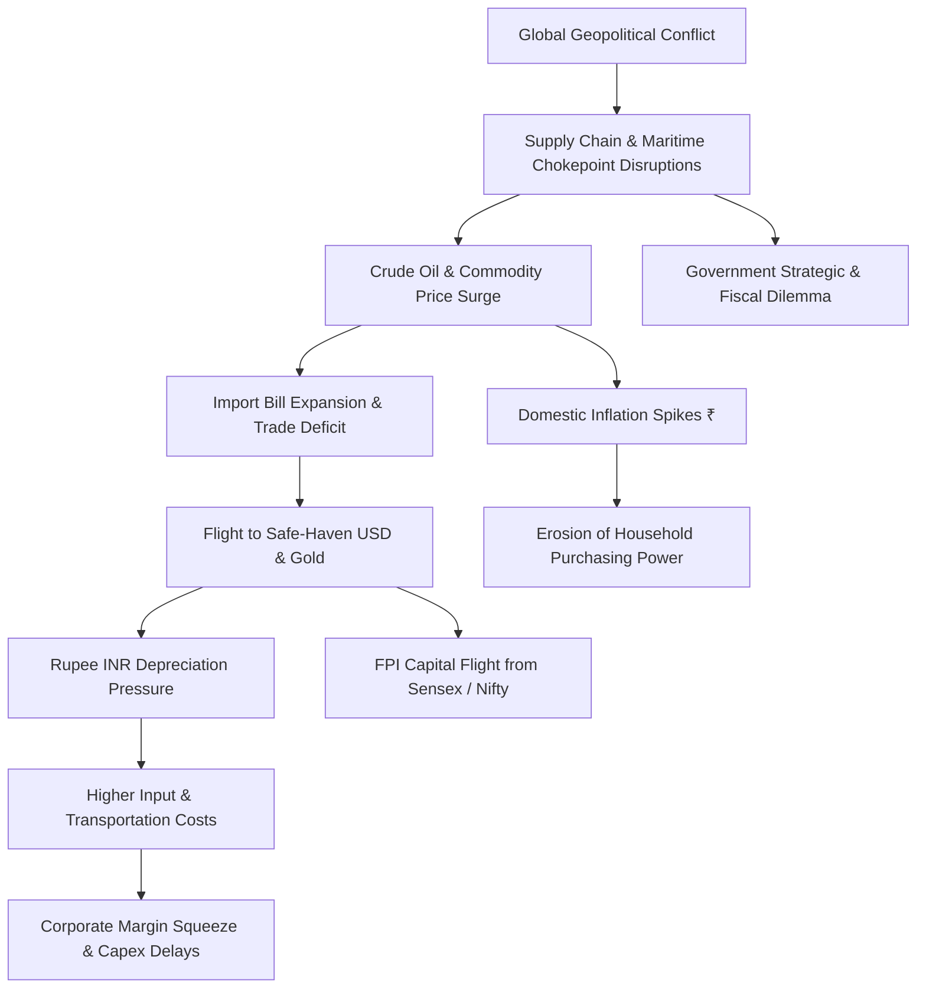

# How War Affects the Indian Economy and Its Financial System

> **Executive Macroeconomic Intelligence Briefing & Interactive Presentation Deck**  
> *A collaborative 9-member team research presentation exploring how distant geopolitical conflicts create profound transmission shocks across India's financial architecture, markets, currency, government priorities, and household wallets.*

---

## 📌 Executive Summary

Modern warfare is fought across two simultaneous fronts: the physical battlefield and the **battlefield of money**. In an increasingly interconnected global trade and financial ecosystem, military conflicts occurring thousands of kilometers away do not remain confined within geographical boundaries. 

For an emerging economy like **India**—which imports over 85% of its crude oil and is deeply integrated into global supply lines and foreign capital flows—external conflicts trigger severe transmission shocks:
- **Trade & Supply Disruptions:** Soaring crude oil, commodity, and freight prices.
- **Inflation & Currency Strain:** Weakening Indian Rupee (INR) against the US Dollar and diminished consumer purchasing power.
- **Market Volatility:** Foreign Portfolio Investment (FPI) outflows, equity sell-offs (Sensex/Nifty swings), and safe-haven rushes toward Gold and USD.
- **Fiscal & Geopolitical Strain:** Strategic balancing between defence procurement, citizen security (e.g., Indian maritime seafarers), and domestic development budgets.

> *"We may not be able to prevent every war, but we can prepare our economy to withstand its financial impact."*

---

## 🗺️ Transmission Mechanism Framework

The macroeconomic impact travels along a clear transmission corridor from external geopolitical flashpoints to the domestic consumer:



---

## 👥 9-Member Team Speaker Matrix

Each team member delivers a dedicated module addressing an integral dimension of the macroeconomic chain, complete with transitions and analytical takeaways:

| Member / Speaker | Slide ID | Module Topic | Core Focus & Economic Concept |
| :--- | :--- | :--- | :--- |
| **Person 1: Amrutha** | `slide-1` | **Introduction: The Financial Battlefield** | Global trade linkages, war as a financial shock, transmission concept. |
| **Person 2: Jaswanth** | `slide-2` | **Household Wallets & Currency** | Crude oil dependency, inflation, rupee pressure, wallet impact chain. |
| **Person 3: Prem** | `slide-3` | **Financial Markets & Safe Havens** | Brent crude volatility, INR depreciation, flight to Gold & US Dollar. |
| **Person 4: Srikar** | `slide-4` | **Stock Market Under Pressure (Sensex & Nifty)** | FPI outflows, Russia-Ukraine benchmark (-2,700 pts), sector asymmetry. |
| **Person 5: Prasanna** | `slide-5` | **Macro Economy & Citizen Livelihood** | GDP growth headwinds, supply chain bottlenecks, employment, food inflation. |
| **Person 6: Havila** | `slide-6` | **Government Response & Maritime Security** | Indian seafarers (1 in 10 globally), Black Sea/Red Sea security, 3-point peace proposal. |
| **Person 7: Swathi** | `slide-7` | **Core Strategic Challenges** | Import reliance, fiscal balancing (defence vs social welfare), corporate capex freezes. |
| **Person 8: Subhashita** | `slide-8` | **Solutions & Resilience Playbook** | Trade diversification, domestic manufacturing (Make in India), fiscal discipline. |
| **Person 9: Divya** | `slide-9` | **Synthesis & Grand Conclusion** | Systemic recap, resilience over prevention, final strategic statement. |

---

## 🎙️ Detailed Speaker Scripts & Module Outlines

The presentation script is organized sequentially to provide smooth handoffs between speakers.

---

### 🎙️ Person 1: Amrutha — Introduction & The Battlefield of Money
- **Slide Reference:** `slide-1`
- **Opening Speech:**
  > *"Good morning everyone.  
  > We are here to present our topic 'How War Affects the Indian Economy and its financial system'.  
  > Before we start, let me introduce our team. We are a team of 9 members, and each of us will explain a different part of the topic. Before we go into the main topic, let me give you a simple introduction about what is war:  
  > “When we hear the word war, the first things that come to our mind are soldiers, weapons and destruction.  
  > But there is another battlefield that we often don't see — **the battlefield of money**. Today, countries are deeply connected. India buys from other countries, sells to them, and does business with people and companies around the world.  
  > So when a war happens somewhere, the impact doesn't always stop at the battlefield. It can travel through the connections between countries and eventually reach India.  
  > Think of it like this:  
  > A war starts in one part of the world… but its consequences can travel much farther. And that is exactly what we are going to explore today — how a war outside India can create effects inside India's financial system. So, instead of looking at war only as a military event, let's look at it as a financial shock that can travel from one country to another.”  
  > “The battlefield may be far away… but the impact can reach our pockets, our businesses and our country.”  
  > “So, let's see how this happens.”"*
- **Handoff Cue to Person 2:**  
  > *(Person 2): "Now that we understand how war can reach India, let’s see how it affects our daily expenses, prices, and currency."*

---

### 🎙️ Person 2: Jaswanth — How War Hits Our Wallet
- **Slide Reference:** `slide-2`
- **Topic:** The Impact of War on Prices and Currency
- **Core Speech:**
  > *"Good morning everyone.  
  > Today, I am going to speak about “How War Hits Our Wallet – The Impact of War on Prices and Currency.”  
  > When we think about war, we think about destruction and loss of lives. But war also affects the economy and our daily expenses.  
  > First, war can disrupt the supply of oil, food, and raw materials. When supply decreases, prices usually increase.  
  > For India, this is important because we import a large amount of crude oil. Higher oil prices can increase transportation and production costs, which can make everyday products more expensive.  
  > War can also cause inflation. Inflation means prices increase and the purchasing power of our money decreases. For example, ₹1,000 may buy fewer things than before.  
  > Another major impact is on the Indian rupee. During uncertainty, investors often prefer safer currencies like the US dollar. This can weaken the rupee and make imports more expensive.  
  > So, the simple chain is:  
  > **War → Supply disruption → Higher prices → Inflation → Rupee pressure → Higher import costs → Impact on our wallet.**  
  > Therefore, even a war far away from India can affect us through fuel prices, food prices, inflation, and the value of our currency.  
  > Thank you."*
- **Handoff Cue to Person 3:**  
  > *(Person 3): "We have seen how war reaches our wallets through prices and the rupee. Now, let’s look at how these changes affect the market."*

---

### 🎙️ Person 3: Prem — How War Meets the Market
- **Slide Reference:** `slide-3`
- **Topic:** Market Volatility, Crude Oil, Rupee, Gold & Dollar
- **Core Speech:**
  > *"Wars can create short-term uncertainty and sharp market swings. India is particularly exposed when conflict disrupts oil supplies, because higher import costs can affect inflation, the rupee and company profits.  
  > - **High volatility:** News about conflict, oil supply or possible escalation can quickly change investor expectations, causing prices to swing sharply.  
  > - **Rising crude oil prices:** Supply disruptions or fears of disruption can push oil prices up. For India, this can raise the import bill and costs for fuel, transport and businesses, while adding inflation pressure.  
  > - **Rupee depreciation:** Higher oil-import costs increase demand for dollars; during periods of global uncertainty, investors may also seek dollar assets. These pressures can weaken the rupee, although RBI action may help smooth abrupt movements.  
  > - **Movement towards gold and the US dollar:** Investors may shift some money into assets they consider safer during uncertainty. This can support gold and the dollar, while reducing demand for riskier assets such as shares.  
  > - **Stock-market volatility:** Investors may sell shares or delay buying when uncertainty rises. Oil-sensitive businesses can face higher costs, while the wider market may react to weaker sentiment and concerns about inflation and economic growth."*
- **Handoff Cue to Person 4:**  
  > *(Person 4): "We’ve seen the wider market reactions to war. Now, let’s focus on the Indian stock market, especially the Sensex and Nifty 50."*

---

### 🎙️ Person 4: Srikar — Stock Market Under Pressure (Sensex & Nifty 50)
- **Slide Reference:** `slide-4`
- **Topic:** Stock Market Under Pressure (Sensex & Nifty 50)
- **Core Speech:**
  > *"Good afternoon, ladies and gentlemen.  
  > So far, we have seen how wars affect different sectors and the Indian economy. Now, let's step into the shoes of investors and look at their impact on the Indian stock market - Sensex and Nifty 50.  
  > To begin with, the most immediate impact is **market volatility**. Geopolitical uncertainty creates fear, leading to sudden selling. For example, when the Russia-Ukraine conflict began in February 2022, the **Sensex fell by over 2,700 points in a single session**.  
  > Moving from market sentiment to capital flows, **foreign investment can also decline**. FPIs may withdraw money from emerging markets and move towards safer assets, putting pressure on Indian stocks and the rupee.  
  > But the biggest concern for India is **crude oil**. Higher oil prices increase our import bill, inflation and production costs. At the same time, a weaker rupee makes these imports even more expensive.  
  > Beyond oil, wars can also affect global trade, disrupting supply chains and increasing freight costs and delivery times.  
  > However, the impact is not equal across sectors. Aviation and automobiles may face higher costs, while defence, metals and upstream oil companies may benefit.  
  > So, to conclude:  
  > **“War creates the shock, but economic fundamentals determine its duration and ultimate impact on the Indian stock market.”**  
  > Thank you."*
- **Handoff Cue to Person 5:**  
  > *(Person 5): "The stock market is only one part of the picture. Let’s now see how these effects spread to the Indian economy and people’s livelihoods."*

---

### 🎙️ Person 5: Prasanna — Impact of War on the Indian Economy
- **Slide Reference:** `slide-5`
- **Topic:** Impact of War on the Indian Economy (Unemployment, Growth & Livelihoods)
- **Core Speech:**
  > *"Good morning everyone.  
  > Today, I am going to speak about the impact of war on the Indian economy.  
  > War affects India in many ways:  
  > - First, it can lead to **unemployment**, as businesses may face difficulties and reduce job opportunities.  
  > - Second, war can cause **lower economic growth**, affecting the country's development.  
  > - Third, it can **increase food prices**, making daily life difficult for ordinary people.  
  > - War can also **disturb international trade** and create shortages of essential goods.  
  > As a result, poor and middle-class families may face more financial problems.  
  > To conclude, war not only destroys lives but also affects a country's economic development and people's living standards.  
  > Thank you."*
- **Handoff Cue to Person 6:**  
  > *(Person 6): "We’ve seen how war affects jobs, prices, trade, and growth. Now, let’s understand what the Indian government does in response."*

---

### 🎙️ Person 6: Havila — How War Affects the Government & Its Response
- **Slide Reference:** `slide-6`
- **Topic:** Indian Seafarers, Peace Proposals & Maritime Security
- **Core Speech:**
  > *"Good morning, everyone.  
  > As you have already heard from my teammates, this war has affected India's market, banking sector, and economy.  
  > Now, let me explain another important aspect: the impact of the war on the Indian government and its response.  
  > India has many citizens working on ships around the world. In fact, **roughly one out of every ten seafarers globally is Indian**. Seafarers are people who work on ships, such as sailors and marine engineers.  
  > Imagine going to work on a ship and suddenly finding yourself in a war zone. You are not a soldier, but your life is still in danger.  
  > Indian sailors have been affected by attacks on commercial ships. This creates a major responsibility for the Indian government: **protecting its citizens, raising concerns with the countries involved, and condemning attacks on commercial vessels**.  
  > India also supported a **three-part peace proposal** to reduce the dangers of the war:  
  > 1. First, stop attacks on energy facilities and important infrastructure.  
  > 2. Second, keep Black Sea ports open so essential goods, such as grain and energy, can move safely.  
  > 3. Third, stop attacks on commercial ships travelling through the Black Sea.  
  > In simple words, India wanted to protect important facilities, maintain the movement of essential goods, and make shipping safer.  
  > Another major concern is India's **economic stability**. India depends on international shipping for oil and other essential goods. When shipping routes become unsafe, supplies can be disrupted and transportation costs can rise, putting additional pressure on the government.  
  > To conclude, the war has challenged the Indian government in three major areas: **protecting Indian citizens, maintaining diplomatic relations, and safeguarding economic interests**. This shows that even when a war happens thousands of kilometres away, its consequences can still reach India, and the government must respond.  
  > Thank you."*
- **Handoff Cue to Person 7:**  
  > *(Person 7): "The government’s response shows how serious these effects can be. Next, let’s look at the major challenges India faces because of war."*

---

### 🎙️ Person 7: Swathi — Challenges India Faces
- **Slide Reference:** `slide-7`
- **Topic:** Trade Disruption, Government Finances & Business Uncertainty
- **Core Speech:**
  > *"Now that we have seen how war affects different parts of the financial system, let us look at the major challenges India may face:  
  > 1. **International trade disruption:** During a war, trade routes and the supply of raw materials can be affected. This can create difficulties for Indian industries that depend on imports.  
  > 2. **Pressure on government finances:** The government may need to spend more on defence and national security while continuing to invest in education, healthcare and development.  
  > 3. **Business uncertainty:** When global conditions become unpredictable, companies may postpone investments and expansion plans, which can affect employment and economic growth.  
  > So, the impact of war goes beyond financial markets. It can also affect India's industries, government priorities and future development.  
  > Now, let us look at how India can respond to these challenges and build a stronger, more resilient economy."*
- **Handoff Cue to Person 8:**  
  > *(Person 8): "Now that we understand the challenges, let’s explore the steps India can take to reduce these risks and build resilience."*

---

### 🎙️ Person 8: Subhashita — Solutions: How India Can Respond
- **Slide Reference:** `slide-8`
- **Topic:** Trade Diversification, Domestic Manufacturing, Fiscal Discipline & Resilience
- **Core Speech:**
  > *"The first step is to **diversify our trade partners**. India should avoid depending too much on a single country for important goods and raw materials. By having alternative sources, we can reduce the risk of supply disruptions.  
  > The second step is to **strengthen domestic manufacturing**. By producing more essential goods within India, we can reduce external dependence, support Indian industries and create employment opportunities.  
  > The third step is to **maintain fiscal discipline**. During a crisis, the government may need to spend more on defence and other essential needs. However, this spending must be carefully planned so that long-term development is not affected.  
  > Finally, India should focus on **long-term economic resilience**. This means improving infrastructure, strengthening important industries and preparing for future global uncertainties.  
  > To conclude, India may not be able to control global conflicts, but it can prepare itself to face their economic consequences.  
  > **A strong economy is not one that never faces challenges, but one that can withstand them and recover.**"*
- **Handoff Cue to Person 9:**  
  > *(Person 9): "These solutions show how India can prepare for future uncertainty. Finally, let’s bring together the key points of our presentation."*

---

### 🎙️ Person 9: Divya — Conclusion: Summarising the Impact
- **Slide Reference:** `slide-9`
- **Topic:** Summary of Impact on India & Final Strategic Line
- **Core Speech:**
  > *"Finally, I would like to conclude our presentation by summarising the impact of wars on India and its financial economy:  
  > - War is not only a military issue. It can become an economic and financial issue.  
  > - It can affect markets, prices, currency, banks, government spending and economic growth.  
  > - India cannot control wars in other countries, but it can prepare itself to handle their effects.  
  > - A strong financial system, diversified trade and a resilient economy can reduce the impact.  
  > 
  > **Strong final line:**  
  > > **“We may not be able to prevent every war, but we can prepare our economy to withstand its financial impact.”**"*

---

## 📊 Sectoral Impact Matrix (Indian Equities)

How different sectors of the Indian economy react to wartime shocks:

| Sector | Impact Direction | Primary Transmission Driver | Examples |
| :--- | :---: | :--- | :--- |
| **Aviation & Logistics** | 🔴 Negative | Jet fuel (ATF) surge, airspace detour costs, elevated maritime freight rates. | InterGlobe (IndiGo), Container Corp |
| **Automotive & Paints** | 🔴 Negative | Crude-derived inputs, elevated metal prices, discretionary consumption slowdown. | Maruti Suzuki, Asian Paints |
| **Upstream Oil & Gas** | 🟢 Positive | Realized crude price surges on domestic extraction assets. | ONGC, Oil India |
| **Defence & Aerospace** | 🟢 Positive | Accelerated indigenization, increased Ministry of Defence procurement orders. | HAL, Bharat Electronics (BEL) |
| **Banking & Financials** | 🟡 Mixed / Volatile | Initial FPI outflow pressure and bond yield spikes; cushioned by domestic credit demand. | HDFC Bank, SBI, ICICI Bank |
| **Information Technology** | 🟡 Neutral / Mixed | Benefit from weaker INR offsetting potential Western IT spending caution. | TCS, Infosys |

---

## 💻 Interactive Presentation Deck (`index.html`)

An interactive presentation deck is located in this directory, built with vanilla HTML5, CSS3, and modern JavaScript:

### 🌟 Deck Capabilities
- **Cinematic Prologue (`slide-0`):** Multi-scene opening transition animating the global conflict transmission map into the Indian subcontinent.
- **Dedicated Speaker Modules (`slide-1` to `slide-9`):** 1:1 alignment with each presenter's speaking topic, complete with speaker identity chips and timer readouts.
- **Interactive Macro Visuals:**
  - Interactive Wallet Impact Flowchart (`slide-2`)
  - Live Multi-Asset Historical Trend Canvas (`slide-3`)
  - Asymmetric Sector Winners & Losers Grid (`slide-4`)
  - Dynamic Shock Distribution Radar / Bar Breakdown (`slide-5`)
  - Strategic Maritime Chokepoint Map & Diplomatic Pillars (`slide-6`)
  - Macroeconomic Trilemma Visualizer (`slide-7`)
  - Interactive Strategic Resilience Quad-Matrix (`slide-8`)
  - Synthesis Takeaway Cards (`slide-9`)
- **Keyboard Navigation Controls:**
  - `→` or `Space`: Advance to next slide / scene
  - `←`: Return to previous slide
  - `F`: Toggle Fullscreen mode
  - `O`: Toggle Slide Overview drawer

### 🚀 Running the Presentation Deck Locally
Simply open [`index.html`](file:///d:/PPT/index.html) in any modern web browser (Google Chrome, Microsoft Edge, Mozilla Firefox, or Safari):

```bash
# Windows PowerShell
Start-Process "d:\PPT\index.html"
```

Or serve via any local static server:
```bash
# Using Python
python -m http.server 8080
# Then visit http://localhost:8080 in your browser
```

---

## 📂 Repository File Structure

```
d:/PPT/
├── README.md                      # Complete project overview, speaker matrix & scripts
├── index.html                     # Interactive 10-slide HTML5 presentation deck
├── presentation speech .docx       # Original Word document containing speaker scripts
├── extracted_speech.txt           # Extracted plain text copy of the presentation script
└── assets/                        # Visual presentation assets & diagrams
    ├── financial_markets.jpg      # Financial volatility & trading floor visual
    ├── india_strategic_reserves.jpg # Energy storage & strategic asset imagery
    ├── maritime_chokepoints.jpg   # Shipping routes & naval security visual
    └── speakers/                  # Directory for presenter profile photographs
```

---

## 🎓 Academic / Institutional Citation

- **Topic:** How War Affects the Indian Economy and Its Financial System
- **Presentation Format:** 9-Member Collaborative Economic Intelligence Briefing
- **Research Scope:** Macroeconomics, Geopolitical Risk Transmission, Crude Oil Dynamics, FX & Monetary Policy (RBI), Equity Sectoral Analysis (BSE/NSE).
